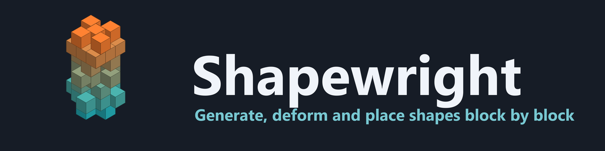
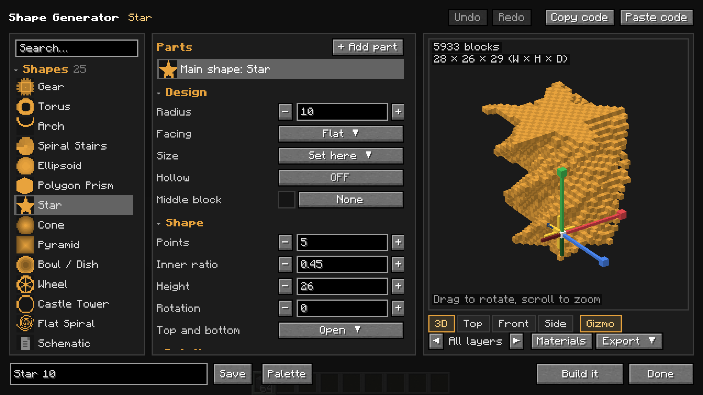
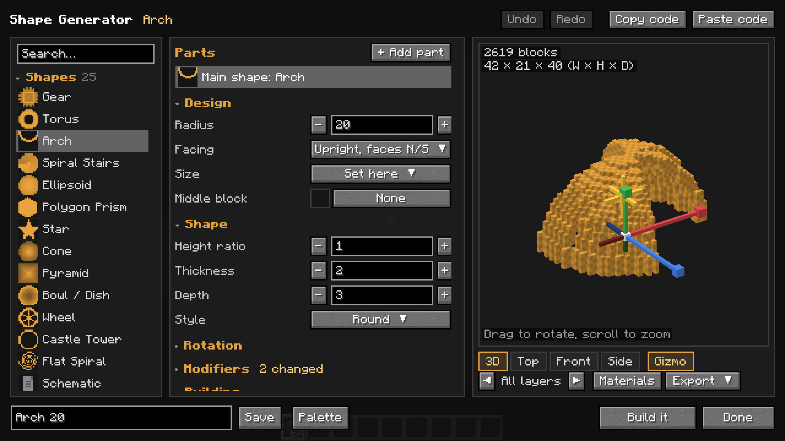
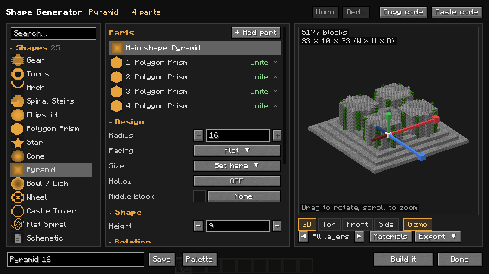

<p align="center"></p>

Shapewright is a building mod for Minecraft 1.21.1 (NeoForge and Fabric). Pick a shape, deform it, preview it in the world and place it in one click. It also has mirrors, arrays, build modes, palettes and a block randomizer. Works in survival mode too.

> **Based on [Effortless Building](https://github.com/Requios/effortless-building-multi) by Requios** (LGPLv3). Shapewright is a fork that has grown into its own mod, with a new id, so it does not replace or conflict with the original.

* Shape Generator with 30+ shapes, combine parts (unite, subtract, intersect), tilt and rotate
* Modifiers: twist, taper, shear, wave, bend, grow/shrink, noise, decimate, with a movable origin
* Preview with the real block textures of your palette and parts
* 3D gizmo that shows the anchor and the modifier origin, in the editor and in the world
* Place and break many blocks at once, mirror, array, undo and redo
* Block palettes, schematics, pixel art, randomizer bag
* Fully supported in survival mode

## Screenshots

*Star prism with twist 180 and taper, with the gizmo on.*


*Arch with bend 90 and wave. The Modifiers section lists what changed.*


*The preview draws the real block textures of your blocks, parts and palette.*

## Shape Generator
Open it from Shape mode in the radial menu (hold ALT). The left side lists saved templates, the middle shows a live 3D preview, the right side holds the settings, grouped into Design, Shape, Heights, Rotation, Modifiers and Build.

**Modifiers** reshape any shape (and every part of it) while keeping its layers, so walls stay solid:

* **Twist**: rotates each layer around an axis, like Blender's twist
* **Taper**: scales layers toward one end
* **Shear**, **Wave**, **Bend**: slide layers sideways, in a ripple, or along an arc
* **Grow / Shrink**: add or remove a shell of blocks
* **Noise** and **Decimate**: rough up or thin out the surface (stable for a given seed)

Choose the deform axis and an origin (start, center, end plus x/y/z offsets). The **Gizmo** tab toggles the red/green/blue axis gizmo at the anchor and a yellow cross at the modifier origin.

## Build Modes
</iframe>

Hold ALT to open the radial menu and select a build mode. With a block in hand, right-click to pick the starting position. Aim somewhere else, then right-click again to build the shape.

Build modes can be used to place blocks, break blocks, and interact with certain blocks. When holding a tool, right-clicking will interact with all the blocks in the shape. For example, stripping logs with an axe, pathing with a shovel, tilling with a hoe, and placing liquids with a bucket.

Available build modes:
* Disabled
* Single
* Line
* Wall
* Floor
* Cube
* Diagonal Line
* Diagonal Wall
* Slope Floor
* Circle
* Cylinder
* Sphere

On the right side of the radial menu you can find additional options for each build mode. On the left side you can find buttons for undo/redo, replace options, opening the modifier settings and config screens.

</iframe>
</iframe>

## Build Modifiers
</iframe>

Modifiers can place additional blocks for each block you placed. You can enable any number of modifiers in the modifier settings. Open the modifier settings with the button in the radial menu, or use the keybind (default NUMPAD+).

* Mirror. Place a mirror at a position of a certain size. Each block placed on one side gets mirrored to the other side.
* Array. Copies the block you placed in a certain direction a certain number of times. Useful for repeated builds like tunnels and walls.
* Radial Mirror. Divides an area in slices around a central point. Each slice copies your block placements.


## Randomizer Tool

This item allows you to place random blocks. Configure the tool by shift-rightclicking when in hand. 

* Use it in combination with build modes and build modifiers.
* While placing a shape, you can open the randomizer tool and change its settings. You can preview those settings in realtime!
* Setting the ratio of an empty slot will cause air gaps to appear in your shape.


Crafting recipe: 3 iron ingots, 1 redstone dust, 1 any flower.

## Replace Options
Use the button to the left of the radial menu to cycle through replace options.

* **Replace Only Air**: You can only place blocks where there was air. Replaceables such as short grass and ferns can still be replaced.
* **Replace Blocks And Air**: You can replace blocks and air.
* **Replace Only Blocks**: You can only replace blocks, not air.
* **Filter By Offhand**: You can only replace blocks that match the block in your offhand.

## Undo and Redo
Press CTRL+Z to undo and CTRL+Y to redo placing blocks.

## Survival-friendly
Playing this mod in survival mode is fully supported. All actions consume the right number of blocks from your inventory. It is fully configurable, so you can find settings that feel balanced for you. 

Here's a small sample of what you can configure:
* How far away you can place blocks
* The maximum number of blocks placed at once
* The maximum size of the mirror and array
* Whether you can break and replace multiple blocks at once, including if tools are required, if they should use durability, etc. By default, you can break and replace blocks that you placed in the same play session.

The functional settings can be found in the radial menu. On a server, you can only edit functional settings if you are an admin.


## Installing
Needs to be installed on both server and client. Requires owo-lib on the client. Optional: Applied Energistics 2 (pull materials from an ME network).

Saved data from the old Effortless Building ids (client config, palettes, shape templates, per-world settings) is moved to the new names the first time you start.

## Building
```
./gradlew build
```
Needs JDK 21. See `AGENTS.md` for architecture notes.

## Credits
* **Effortless Building** by [Requios](https://github.com/Requios): the original mod this is based on. Thanks to everyone who ported it: Grimmauld (1.16), Dashos (fake player fixes) and manapart (1.19).
* Radial Menu inspired by [Chisels & Bits](https://www.curseforge.com/minecraft/mc-mods/chisels-bits) by AlgorithmX2.
* Build Modes inspired by [Linear](https://www.curseforge.com/minecraft/mc-mods/linear) by Tschipp.
* Shapewright by [watdafawx](https://github.com/watdafawx).

## License
LGPL-3.0, same as the original. See `LICENSE`. Significant changes from Effortless Building are listed in the git history.
